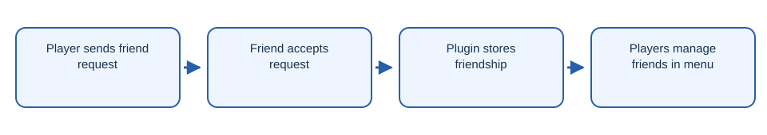

# NeonFriends

Minecraft friends plugin with friend requests and an in game menu.

## Workflow

1. Player sends friend request.
2. Friend accepts request.
3. Plugin stores friendship.
4. Players manage friends in menu.

## Getting started

Build with `mvn package` and install the JAR on a compatible Paper server.

## License

No new license is granted for contributors’ existing code. Contact the contributors before reuse or relicensing.
